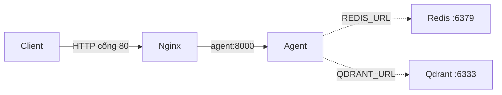

# Day 14 — Mission Answers

## Part 1 — Localhost vs Production

### Exercise 1.1 — Anti-patterns

1. API key giả và chuỗi kết nối DB nằm trong source ở [`develop/app.py:17–18`](01-localhost-vs-production/develop/app.py#L17-L18). Nếu làm tương tự với secret thật, người đọc repo và lịch sử Git đều có thể lấy được chúng.
2. `DEBUG` và `MAX_TOKENS` cố định trong code. Muốn cấu hình khác cho staging phải sửa source.
3. Các lệnh `print()` ghi cả câu hỏi, câu trả lời và API key. Log thiếu các trường nhất quán để tìm lỗi và làm dữ liệu nhạy cảm đi vào hệ thống thu thập log.
4. Thiếu `/health` và `/ready` nên môi trường chạy không có tín hiệu riêng về trạng thái tiến trình và khả năng nhận tải.
5. Bind vào `localhost` và cố định cổng 8000 nên container không nhận được traffic qua địa chỉ của nó và bỏ qua cổng nền tảng cấp.
6. `reload=True` chạy cơ chế theo dõi file vốn dành cho phát triển, tạo thêm tiến trình và có thể khởi động lại khi file thay đổi.
7. Chưa có hook đóng kết nối hay hoàn tất cleanup lúc tiến trình tắt.

### Exercise 1.2 — Chạy bản develop

Gọi `POST /ask?question=What%20is%20Docker%3F` với câu hỏi trên query string.

```http
HTTP/1.1 200 OK
server: uvicorn
content-type: application/json

{"answer":"Container là cách đóng gói app để chạy ở mọi nơi. Build once, run anywhere!"}
```

### Exercise 1.3 — So sánh

| Hạng mục | Develop | Production | Lý do |
| --- | --- | --- | --- |
| Cấu hình | Hardcode key, port, debug | `os.getenv` trong [`production/config.py`](01-localhost-vs-production/production/config.py#L16) | Cùng source và image chạy được ở các môi trường, đổi secret qua cấu hình. |
| Network | `localhost:8000` | Mặc định bind `0.0.0.0`, đọc `PORT` | Proxy bên ngoài container kết nối được. |
| Probe | Chỉ có route ứng dụng | `GET /health` và `GET /ready` kiểm tra cờ sau startup | Tách quyết định kiểm tra tiến trình khỏi quyết định gửi traffic. |
| Logging | `print()` cả key và nội dung | Dùng logger, các event request/response ghi độ dài thay cho nội dung | Có thể lọc log theo trường và giảm dữ liệu nhạy cảm. |
| Shutdown | Chưa có cleanup | [`lifespan`](01-localhost-vs-production/production/app.py#L40) chạy cả startup và shutdown | Có chỗ đóng tài nguyên sau khi xử lý request đang chạy. |

Ở bản production, `GET /health` trả 200 với `status: ok` và `GET /ready` trả 200 với `{"ready":true}`.

## Part 2 — Docker

### Exercise 2.1 — Dockerfile develop

1. Base image là `python:3.11`.
2. Working directory trong container là `/app`.
3. Copy `requirements.txt` và cài gói trước khi copy source để Docker tái sử dụng layer dependencies khi chỉ sửa code.
4. `ENTRYPOINT` xác định chương trình chính của container. `CMD` cung cấp lệnh mặc định hoặc các tham số mặc định cho `ENTRYPOINT`. Đối số sau tên image ghi đè `CMD`, còn muốn thay chương trình chính thì dùng `--entrypoint`.

### Exercises 2.2–2.3 — Chạy container và đo image

Build hai Dockerfile từ gốc repo, dùng `docker images my-agent` và `docker image inspect --format '{{.Size}}'` để lấy số byte chính xác.

| Image | `docker images` (disk usage) | Size (byte) | Size (MB thập phân) |
| --- | --- | ---: | ---: |
| `my-agent:develop` | 1.67 GB | 1.667.784.012 | 1.667,78 |
| `my-agent:advanced` | 240 MB | 239.815.475 | 239,82 |

Image advanced nhỏ hơn **85,62%** theo công thức `(1 − size_advanced / size_develop) × 100`. Stage builder cài compiler, thư viện build và Python dependencies. Stage runtime dùng base slim, chỉ copy thư viện Python đã cài và source cần chạy, rồi chạy với user non-root.

Bản develop khởi động trong container, `/health` trả `{"status":"ok","uptime_seconds":0.2,"container":true}` và `POST /ask?question=What%20is%20Docker%3F` trả `HTTP/1.1 200 OK` cùng câu trả lời mock về Docker.

### Exercise 2.4 — Docker Compose



Bốn service nằm cùng mạng `internal`. Compose đợi Redis và Qdrant healthy trước khi bật agent. Nginx nhận HTTP, giới hạn tốc độ theo IP và proxy request tới agent. Hai URL phụ thuộc được cấu hình cho agent. Bản minh họa trả lời bằng mock LLM.

Kiểm tra qua Nginx cho kết quả `GET /health → HTTP/1.1 200 OK` và `POST /ask` với body `{"question":"Explain microservices"}` trả `HTTP/1.1 200 OK`. Cả hai phản hồi có header `Server: nginx`.

## Part 3 — Cloud Deployment

### Exercises 3.1–3.2 — Railway và Render

Cấu hình deploy cho agent Part 6 nằm trong [`06-lab-complete/`](06-lab-complete/). Chọn Render làm phương án chính. Phần cloud dừng ở cấu hình theo phạm vi đã chọn. URL public và ảnh deploy chờ lần chạy trên cloud. Xem [DEPLOYMENT.md](DEPLOYMENT.md) để biết Blueprint Path, biến môi trường và bốn lệnh kiểm tra.

| Cấu hình | Railway | Render |
| --- | --- | --- |
| Phạm vi | `railway.toml` chọn builder Dockerfile và khai báo health check cho một service. | `render.yaml` là Blueprint khai báo web service Docker cùng dịch vụ Key Value. |
| Health check | `healthcheckPath = "/health"` và timeout 30 giây. | `healthCheckPath: /health` trên web service. |
| Redis và secret | Service Redis được tạo trong project, URL và key được đặt trong Variables của service agent. | Render sinh API key bằng `generateValue` và đưa URL Redis nội bộ vào agent qua `fromService`. |

Render Blueprint có thể dựng cả agent và Redis từ một file. Railway lưu cấu hình build/deploy và liên kết các service qua cấu hình project.

### Exercise 3.3 — Cloud Run

1. Cloud Build cài dependencies và chạy `pytest tests/` trong container Python.
2. Sau khi test pass, Docker build image với tag `$COMMIT_SHA` và `latest`, dùng image `latest` làm cache nếu có.
3. Build đẩy các tag lên registry rồi deploy image theo SHA lên Cloud Run tại `asia-southeast1`, cài giới hạn tài nguyên và gắn secret từ Secret Manager.
4. `service.yaml` mô tả service dưới dạng IaC, gồm cổng 8000, scaling 1–10 instance, concurrency 80, startup probe `/ready` và liveness probe `/health`.

## Part 4 — API Security

### Exercise 4.1 — API key

Dependency `verify_api_key` đọc `X-API-Key` và so sánh với `AGENT_API_KEY`. Key thiếu hoặc sai trả 401. Để xoay key, đặt giá trị mới qua biến môi trường, cập nhật client và triển khai lại. Nếu cần chuyển tiếp mượt, thiết kế một thời điểm chấp nhận cả hai key rồi thu hồi key cũ.

Hai lần gọi `POST /ask` bản develop bằng `curl -i` cho kết quả sau. API key đã được giữ ngoài đầu ra.

```http
HTTP/1.1 401 Unauthorized
content-type: application/json

{"detail":"Missing API key. Include header: X-API-Key: <your-key>"}
```

```http
HTTP/1.1 200 OK
content-type: application/json

{"question":"What is Docker?","answer":"Container là cách đóng gói app để chạy ở mọi nơi. Build once, run anywhere!"}
```

### Exercises 4.2–4.3 — JWT và rate limiting

`POST /auth/token` kiểm tra tài khoản demo `student` và phát JWT bearer. Token chứa danh tính, role, thời điểm phát hành và hết hạn sau 60 phút. Các lần gọi sau dùng `Authorization: Bearer <token>`. Dependency kiểm tra chữ ký HS256 và hạn token trước khi chọn giới hạn theo role. Lần gọi đầu với bearer token trả `HTTP/1.1 200 OK` và `requests_remaining: 9`.

Limiter của bản mẫu là sliding window trong RAM theo username. Nó loại timestamp cũ ngoài 60 giây và đếm các timestamp còn lại. Tài khoản thường có 10 lượt/phút, admin có limiter riêng với 100 lượt/phút. Role được đọc từ JWT đã xác thực. Một lượt đã dùng ở bài 4.2, nên vòng lặp 20 lượt tiếp theo nhận 9 mã 200, sau đó 11 mã 429. Response 429 đầu tiên có nội dung sau.

```http
HTTP/1.1 429 Too Many Requests
x-ratelimit-limit: 10
x-ratelimit-remaining: 0
retry-after: 58
content-type: application/json

{"detail":{"error":"Rate limit exceeded","limit":10,"window_seconds":60,"retry_after_seconds":58}}
```

### Exercise 4.4 — Cost guard

Với ngân sách 10 USD/tháng cho từng user, dùng key Redis gồm ID user đã xác thực và tháng UTC. Trước khi gọi LLM, ước lượng chi phí từ input và số output token tối đa. Dùng cùng một lệnh Lua để kiểm tra tổng cộng khoản giữ chỗ có vượt budget không và cập nhật số tiền nếu còn đủ. Key hết hạn đúng đầu tháng tiếp theo. Khi LLM trả về, tính chi phí thực tế từ token input/output rồi hoàn phần giữ chỗ thừa. Hết ngân sách trả 402.

Rate limit khống chế tần suất 60 giây. Cost guard khống chế tổng tiền cả kỳ, kể cả khi request lẻ tốn nhiều token hoặc được gửi đều đặn. Part 6 áp dụng cùng cơ chế giữ chỗ cho ngân sách chung của service.

## Part 5 — Scaling & Reliability

### Exercises 5.1–5.2 — Probe và graceful shutdown

`/health` kiểm tra tiến trình còn hoạt động. `/ready` phản ánh khả năng phục vụ, ví dụ trả 503 khi Redis chết để load balancer ngừng chia traffic tới instance đó. Part 6 được kiểm tra cả hai trường hợp trong bài chấm. Khi Uvicorn nhận SIGTERM, server ngừng nhận kết nối mới, đợi request đang chạy rồi thực thi đoạn cleanup sau `yield` trong lifespan để đóng Redis pool. Bài chấm ghi nhận request đang chạy trả 200 và tiến trình thoát với mã 0.

### Exercises 5.3–5.5 — State, chia tải và kết quả chạy

Mỗi tiến trình có vùng RAM riêng. Nếu conversation history nằm trong `dict` của worker A, worker B sẽ không thấy nó khi Nginx chuyển request. Bản mẫu lưu session theo `session_id` trong Redis để cả ba instance đọc cùng dữ liệu. Các instance nằm sau Nginx, chỉ Nginx mở cổng 8080 trên host.

Kết quả từ `python test_stateless.py` sau khi chạy stack với `--scale agent=3`:

```text
Request 1: [instance-991511]
Request 2: [instance-d7fabf]
Request 3: [instance-991511]
Request 4: [instance-d830f0]
Request 5: [instance-d7fabf]
Total requests: 5
Total messages: 10
✅ Session history preserved across all instances via Redis!
```

`GET /health` qua Nginx báo `storage: redis` và `redis_connected: true`. Năm lượt hỏi tạo năm cặp user/assistant cùng session qua ba instance. Bài chạy này kiểm tra việc chia sẻ state khi phân tải.

## Part 6 — Production Readiness Check

Chạy nguyên script chấm trong Ubuntu WSL2 với Docker Desktop. Image Part 6 đo được 273 MB. Script ghi nhận 429 sau năm request được phép và vẫn còn 429 sau khi restart agent. Probe liveness vẫn 200 khi readiness 503. `docker stop` hoàn tất trong 1,3 giây với mã thoát 0.

```text
  📋 Checklist Deliverable
     ✅ Dockerfile (multi-stage, < 500 MB)
     ✅ docker-compose.yml (agent + redis)
     ✅ .dockerignore
     ✅ Health check endpoint (GET /health)
     ✅ Readiness endpoint (GET /ready)
     ✅ API Key authentication
     ✅ Rate limiting
     ✅ Cost guard
     ✅ Config từ environment variables
     ✅ Structured logging
     ✅ Graceful shutdown
     ✅ Public URL ready (Railway / Render config)
----------------------------------------------------------------
  Result: 12/12 tiêu chí đạt · 43/43 checks passed
  🎉 PASS 12/12 — PRODUCTION READY! Deploy nào!
```

Mục 12 của lần chạy này xác minh cấu hình triển khai. Kiểm thử URL public là bước riêng trong [DEPLOYMENT.md](DEPLOYMENT.md).

## AI log

| Yêu cầu gửi cho AI | AI đã hỗ trợ | Thay đổi và kiểm tra đã thực hiện |
| --- | --- | --- |
| Làm lab Day 14 trong repo local, giữ nguyên Git | Đọc đề, soạn câu trả lời và hoàn thiện agent Part 6, Dockerfile, Compose và cấu hình deploy | Codex cài môi trường test, gọi các API mẫu, đo kích thước image bằng Docker, chạy stack ba replica và chạy bài chấm gốc. |
| Thực hiện benchmark, eval và observability theo đề | Thêm histogram độ dài câu hỏi, bổ sung mục HPA và JWT từ kết quả eval, viết job CI và báo cáo | Codex chạy baseline trước khi sửa KB, chạy lại với quality gate và so hồi quy, tạo tải local và ghi số trực tiếp từ đầu ra JSON/CSV và UI. |

Các lệnh kiểm tra và thu số liệu do Codex chạy trong workspace. Học viên có thể dùng lệnh trong tài liệu để tái lập và tự đối chiếu trước khi nộp.
